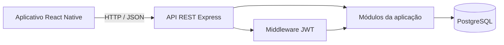

# Blog Educacional — Tech Challenge Fase 4

Projeto desenvolvido para o Tech Challenge da Pós-Graduação em Desenvolvimento Full Stack da FIAP. A aplicação disponibiliza conteúdos educacionais por meio de um aplicativo mobile integrado a uma API REST, permitindo que professores gerenciem postagens, professores e alunos.

## Funcionalidades

### Acesso público (alunos)

- Listagem e pesquisa de postagens.
- Visualização do título, autor, resumo e conteúdo completo das postagens.

### Acesso autenticado (professores)

- Login e logout.
- Cadastro, edição e exclusão de postagens.
- Painel administrativo.
- Cadastro, listagem paginada, edição e exclusão de professores e alunos.
- Gerenciamento administrativo de postagens.

## Tecnologias

| Mobile             | Backend             | Infraestrutura                     |
| ------------------ | ------------------- | ---------------------------------- |
| React Native       | Node.js             | Docker                             |
| Expo / Expo Router | Express             | Docker Compose                     |
| TypeScript         | PostgreSQL / pg     | Git e GitHub                       |
| AsyncStorage       | JWT / bcryptjs      | WSL2 (ambiente de desenvolvimento) |
| Fetch API          | Swagger / node:test |                                    |

## Arquitetura



O aplicativo utiliza componentes funcionais, hooks e navegação baseada em arquivos com Expo Router. A comunicação com o backend é realizada através da Fetch API.

O backend é organizado em módulos de postagens, professores, alunos e autenticação. O módulo de postagens utiliza separação entre responsabilidades de domínio, casos de uso e persistência. Os módulos administrativos utilizam rotas Express com acesso ao banco de dados por meio do pg.

```text
fiap-tech-challenge-quatro/
├── README.md
└── mobile/
    └── src/app/
        ├── (tabs)/
        ├── _layout.tsx
        ├── login.tsx
        ├── admin.tsx
        ├── professores.tsx
        ├── alunos.tsx
        ├── postagens.tsx
        └── posts/
            ├── [id].tsx
            ├── create.tsx
            └── edit/[id].tsx
```

O backend está no projeto separado `blog-tech-challenge`. Ambos os projetos são necessários para executar a solução completa.

## Pré-requisitos

- Node.js 22 e npm.
- Docker e Docker Compose.
- Git.
- Expo Go em dispositivo compatível ou ambiente de emulação compatível com o SDK utilizado.

## Executando o backend

Na raiz do projeto `blog-tech-challenge`:

```bash
npm install
```

Crie um arquivo `.env` com as configurações correspondentes ao seu ambiente. Exemplo:

```dotenv
DB_HOST=localhost
DB_PORT=5432
DB_USER=seu_usuario
DB_PASSWORD=sua_senha
DB_NAME=blog_db
JWT_SECRET=seu_segredo_aleatorio
```

Gere um segredo JWT próprio (por exemplo, com `openssl rand -hex 32`). Não publique o arquivo `.env`.

```bash
docker compose up -d
npm run dev
```

A API estará disponível em `http://localhost:3000`.

### Banco de dados

O PostgreSQL utiliza as tabelas `posts`, `professores` e `alunos`. A tabela de postagens deve ser inicializada conforme o esquema original do backend. Caso as tabelas administrativas ainda não existam, execute no banco `blog_db`:

```sql
CREATE TABLE IF NOT EXISTS professores (
    id SERIAL PRIMARY KEY,
    nome VARCHAR(150) NOT NULL,
    email VARCHAR(150) UNIQUE NOT NULL,
    senha TEXT NOT NULL
);

CREATE TABLE IF NOT EXISTS alunos (
    id SERIAL PRIMARY KEY,
    nome VARCHAR(150) NOT NULL,
    email VARCHAR(150) UNIQUE NOT NULL
);
```

### Cadastro do primeiro professor

Na raiz do backend, após criar as tabelas, execute `node` e utilize o código abaixo, substituindo e-mail e senha por credenciais próprias:

```javascript
const bcrypt = require("bcryptjs");
const pool = require("./src/infrastructure/database/connection");
(async () => {
  try {
    const senha = await bcrypt.hash("TroqueEstaSenha123", 10);
    await pool.query(
      "INSERT INTO professores (nome, email, senha) VALUES ($1, $2, $3) ON CONFLICT (email) DO NOTHING",
      ["Professor Admin", "admin@exemplo.com", senha],
    );
  } finally {
    await pool.end();
  }
})();
```

## Executando o aplicativo mobile

Na raiz do repositório mobile:

```bash
git clone https://github.com/brgcostadev/fiap-tech-challenge-quatro.git
cd fiap-tech-challenge-quatro/mobile
npm install
```

Crie um arquivo `.env` dentro da pasta `mobile`:

```dotenv
EXPO_PUBLIC_API_URL=http://192.168.1.100:3000
```

Substitua o IP ilustrativo pelo endereço acessível do computador que executa o backend. Em dispositivo físico, `localhost` aponta para o próprio celular.

Inicie o Expo:

```bash
npx expo start --tunnel
```

Abra o aplicativo pelo QR Code no Expo Go. O túnel do Expo disponibiliza o aplicativo, mas não expõe automaticamente a API REST: o dispositivo também precisa conseguir acessar o endereço configurado para o backend.

## Endpoints da API

| Método | Endpoint                | Acesso    | Descrição            |
| ------ | ----------------------- | --------- | -------------------- |
| POST   | `/login`                | Público   | Autenticar professor |
| GET    | `/posts`                | Público   | Listar postagens     |
| GET    | `/posts/:id`            | Público   | Consultar postagem   |
| POST   | `/posts`                | Professor | Criar postagem       |
| PUT    | `/posts/:id`            | Professor | Atualizar postagem   |
| DELETE | `/posts/:id`            | Professor | Excluir postagem     |
| GET    | `/professores?pagina=1` | Professor | Listar professores   |
| GET    | `/professores/:id`      | Professor | Consultar professor  |
| POST   | `/professores`          | Professor | Cadastrar professor  |
| PUT    | `/professores/:id`      | Professor | Atualizar professor  |
| DELETE | `/professores/:id`      | Professor | Excluir professor    |
| GET    | `/alunos?pagina=1`      | Professor | Listar alunos        |
| GET    | `/alunos/:id`           | Professor | Consultar aluno      |
| POST   | `/alunos`               | Professor | Cadastrar aluno      |
| PUT    | `/alunos/:id`           | Professor | Atualizar aluno      |
| DELETE | `/alunos/:id`           | Professor | Excluir aluno        |

Swagger: `http://localhost:3000/api-docs` (a cobertura documental dos novos endpoints deve ser conferida).

## Autenticação e segurança

O login valida as credenciais do professor utilizando bcryptjs. Após a autenticação, a API emite um token JWT com validade de oito horas. O aplicativo armazena o token no AsyncStorage e o envia nas requisições protegidas:

```http
Authorization: Bearer <token>
```

O middleware do backend verifica o token e o perfil do usuário. Os botões administrativos são exibidos conforme a sessão local. O logout remove o token do dispositivo.

## Testes

Para executar os testes automatizados existentes no backend:

```bash
npm test
```

Roteiro de testes manuais do aplicativo:

- Acesso público, pesquisa e leitura de postagens.
- Login e logout do professor.
- Criação, edição e exclusão de postagens.
- CRUD e navegação entre páginas de professores e alunos.
- Acesso ao painel administrativo e restrições para visitantes.
- Tentativas de executar operações protegidas sem token.

## Desafios e aprendizados

- Comunicação entre o aplicativo em dispositivo Android físico, WSL2 e API local.
- Configuração de rede, firewall e portas de desenvolvimento.
- Compatibilidade de dependências com o Expo SDK.
- Integração de autenticação JWT com as requisições mobile.
- Atualização das listagens ao retornar às telas e sincronização após operações de CRUD.
- Organização da navegação e controle de acesso às funcionalidades administrativas.

## Limitações e melhorias futuras

- O acesso de alunos é público, sem autenticação individual.
- Os comentários não foram incluídos no escopo implementado.
- O ambiente de desenvolvimento usa HTTP; em produção, recomenda-se HTTPS e armazenamento seguro de tokens.
- Recomenda-se ampliar a cobertura de testes dos módulos administrativos e revisar vulnerabilidades das dependências antes de disponibilizar a aplicação em produção.
- A checagem de sessão no mobile é simplificada; a autorização efetiva das operações protegidas ocorre no backend.

## Conclusão

O projeto integra desenvolvimento mobile, serviços REST, persistência relacional e autenticação, aplicando os conhecimentos adquiridos durante a pós-graduação em uma solução voltada à gestão de conteúdos educacionais.

Projeto acadêmico — FIAP | Tech Challenge — Fase 4.

## Autor

**Bruno Costa - RM 370510**

Projeto desenvolvido para o Tech Challenge - Fase 3 da Pós-Tech FIAP.
